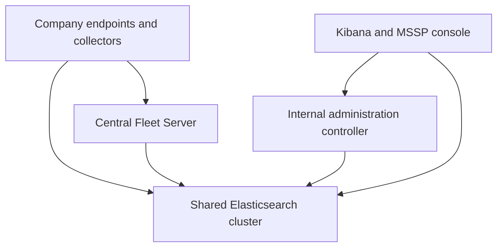

# Elastic Multi-Tenant SIEM
### Centralized security operations for an MSSP

This project documents the evolution of a hands-on Elastic SIEM lab into a centrally managed, multi-company security-monitoring platform. The design combines a shared Elasticsearch cluster, company-specific Kibana spaces and data namespaces, a central Fleet Server, and an MSSP administration console.

**Project status:** deployment candidate under validation. Service readiness and successful onboarding of two test companies have been reported from the lab. They do not establish production acceptance, tenant isolation under every API, or end-to-end detection coverage.

## Why this project exists

An MSSP needs one operational environment for its analysts while each customer sees only its own security information. Manually repeating spaces, roles, policies, dashboards, and rules becomes difficult to maintain as customers grow. This project turns those activities into a controlled company-onboarding workflow.

The public repository explains engineering decisions, operational workflows, and validation criteria. Deployment archives, Docker configuration, container images, certificates, credentials, and customer data are distributed separately and are not added by this documentation update.

## From the original lab to the current design

| Phase | Engineering outcome |
| --- | --- |
| Elastic foundation | Established log ingestion, Kibana navigation, Fleet enrollment, and detection-rule experimentation in an Elastic 8.19 lab. |
| Tenant model | Mapped company identity to a space, data-stream namespace, roles, and agent policy. |
| Central platform | Moved the deployment design to a shared Elastic 9.5.6 environment with TLS and a central Fleet Server. |
| MSSP workflows | Introduced company provisioning, explicit customer-account assignment, team access, enrollment, and approved integration templates through the console. |
| Detection ownership | Added company-scoped rule execution identities and a small enabled baseline alongside the installed prebuilt library. |
| Lifecycle and operations | Added provisioning recovery, suspension/reactivation, deletion previews, health checks, and archive workflows. |

These are engineering phases, not claims that each phase was developed on a particular publication date. See [Project evolution](docs/PROJECT_EVOLUTION.md).

## Architecture

Fleet manages agent policies and enrollment. Agents normally send collected events to Elasticsearch using the configured output; Fleet Server is not a mandatory log-data relay. The console authenticates through Kibana and forwards authorized management requests to an internal controller.

| Component | Responsibility |
| --- | --- |
| Elasticsearch | Stores company data streams, alert indices, security roles, and lifecycle metadata. |
| Kibana | Hosts company spaces, dashboards, investigations, and the MSSP console. |
| Central Fleet Server | Provides one enrollment/control endpoint with a separate agent policy per company. |
| Internal controller | Applies authorized company operations and tracks provisioning jobs. It is not exposed as a public management port. |
| External archive | Intended snapshot repository for older data; requires an actual mounted, verified external destination. |

## Company isolation

A company such as `acme` maps to a space `acme`, policy `mssp-acme`, and namespace `acme`. Its roles target patterns such as `logs-*-acme` and `metrics-*-acme`. The namespace is an exact terminal identifier: appending a wildcard after it would risk matching another company's similarly named namespace.

Spaces organize saved objects; **Elasticsearch privileges enforce data access**. A dashboard filter or a hidden menu is not a security boundary. The controller must independently authorize the company on each request, and rule execution identities must remain limited to that company's resources.

Customers are not granted access to the shared Fleet administration interface or a shared cross-company alert view. Trusted MSSP operators have cross-company responsibilities. Shared infrastructure still has a shared failure domain and resource contention; logical isolation is not a dedicated cluster per customer.

## Operating model

| Account | Intended scope |
| --- | --- |
| Platform administrator | Company lifecycle, accounts, platform configuration, and all-company administration. |
| MSSP operator | Authorized monitoring, investigation, source onboarding, and agent operations across companies. |
| Customer | Read-only access to the assigned company's dashboards and security visibility. |

Company onboarding progresses through resources, system integration, dashboard preparation, and detection rules before reaching `ready`. A failed job retains its stage and error for controlled recovery. Creating an account or enrolling an agent is not a substitute for completing company provisioning.

Agent enrollment uses a company-policy-bound enrollment token. The installer prompts for the token; possession of the correct token is what permits enrollment. Tokens must be protected, and issuing a new token does not automatically revoke older tokens.

Integration onboarding uses approved templates with company policy/namespace assignment enforced by the application. A complete self-service catalog for every vendor is not claimed. Additional cloud, firewall, MDM, and network-traffic sources require reviewed mappings, credentials, collectors, and ingestion tests.

## Detection engineering

The onboarding workflow installs the prebuilt rule library and enables a limited company-scoped baseline:

- Repeated Windows failed logons.
- Repeated Linux authentication failures.
- Windows audit-log clearing.

A rule being installed or enabled does not prove it detects real activity. Relevant integrations, fields, event generation, rule scheduling, API-key scope, and resulting alerts all require validation. Additional prebuilt rules should be selected and tuned for the customer's actual sources and license.

## Retention and recovery

The business target is one year of searchable data followed by three months in an external archive that must be restored before searching. Archive completion must be verified before removing the live copy.

The current archive implementation tracks aging of non-write indices; index age and rollover timing can extend actual event retention beyond fifteen months. An exact event-level deletion deadline is not established. External archive capacity and restore performance must be measured with representative ingestion.

## Company lifecycle

Suspension restricts managed customer access and revokes enrollment credentials while keeping stored data. It does not automatically stop agents collecting or rules running. Reactivation does not resurrect revoked tokens.

Permanent removal is a separate administrator workflow with a resource preview and explicit company confirmation. It targets owned resources and stops on ownership conflicts. Exports, external backups, and source-device files are outside that operation; a failed deletion can leave partially removed resources.

## Evidence and acceptance

Current evidence must be kept separate from the original lab:

- The lab operator reported passing checks for Elasticsearch, Kibana, Fleet Server, the console, and its authenticated bridge.
- Two test companies reached `ready / complete`.
- Local automated tests cover selected controller, provisioning, lifecycle, and interface behavior.
- Customer login, negative cross-company API tests, real endpoint enrollment, alert generation, and external snapshot restore remain deployment acceptance activities unless separately recorded.

Do not apply the original lab's rule counts or test totals to the current release. Single-node operation does not provide high availability. A Basic-license design does not promise paid Elastic capabilities.

## Documentation

- [Project evolution](docs/PROJECT_EVOLUTION.md)
- [Documentation roadmap](docs/ROADMAP.md)

## Lab screenshots

### MSSP console

User-supplied lab capture showing the company selector and console activity interface. The visible banner identifies deployment candidate 0.2.2, and an Unauthorized message is present. This image documents the interface at capture time; it does not demonstrate successful authorization for every operation or the latest release being deployed.

### Kibana space selector

User-supplied capture showing Default and two test-company spaces. The account used is not established by this image. Seeing multiple spaces does not demonstrate customer isolation; negative tests using actual customer accounts are required. Both captures show a browser trust warning, so browser certificate trust was not demonstrated in these sessions.

## Historical context and attribution

The earlier [SIEMEngineing lab](https://github.com/Zaidjarwan02/SIEMEngineing) records a different access model. Its shared customer alert view and enable-all-rules workflow are not current deployment guidance.

Elasticsearch, Kibana, Elastic Agent, integrations, and detection content retain their respective licenses. This independent engineering project is not an official Elastic product. Deployment files are not included in this repository.
